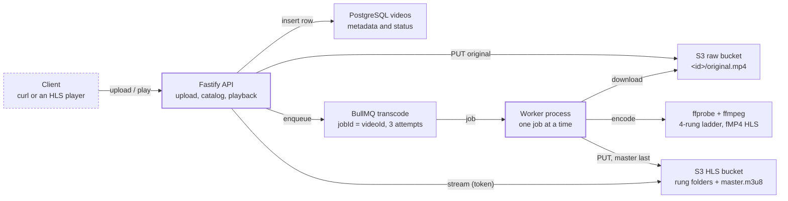

# StreamForge: design notes

Upload an MP4, a worker encodes it into several quality levels as HLS, and playback URLs carry an expiring signature.

## In short

I built StreamForge to learn how video streaming works end to end. The API accepts an upload, stores the original in object storage, records a row in Postgres and enqueues a job. A separate worker runs FFmpeg to produce a four-rung adaptive-bitrate ladder as HLS, uploads the segments, and writes the master playlist last so `ready` always means complete. Playback goes through HMAC-signed, expiring URLs. It is a modular monolith with hand-wired dependencies; there is no auth, player or CDN.

## Architecture

The API returns as soon as the original is stored and a job is queued. The worker does the slow encoding and uploads the master playlist last.

## From upload to playback

1. `POST /upload/videos` accepts only `video/mp4`, streams it to a temp file, and returns 413 if it exceeds the limit (500 MB by default).
2. `uploadService.ingest` generates a UUID and puts the file at `<id>/original.mp4` in the raw bucket.
3. `probeVideo` reads duration and dimensions (it never throws), then the catalog inserts a row with status `uploaded`. If the insert fails, the object is deleted to compensate.
4. `transcode.enqueue(video.id)` adds a job with `jobId = videoId`, three attempts and exponential backoff. The API responds 201.
5. The worker sets status `transcoding`, downloads the original, probes it and calls `selectRungs(source.height)`.
6. For each rung it runs FFmpeg, uploads every file under `<id>/<rung>/`, then probes the output for the real width and height.
7. `buildMasterPlaylist` writes `<id>/master.m3u8`, uploaded last, and the status becomes `ready`.
8. `GET /playback/videos/:id` issues a token and returns a master-playlist URL with the token in the path.
9. Playlist and segment requests verify the token, then stream the object from storage to the reply.

## Libraries

| Library | Used for |
| --- | --- |
| `fastify + @fastify/multipart` | HTTP and streaming uploads. |
| `@aws-sdk/client-s3` | Object storage; MinIO locally. |
| `pg + node-pg-migrate` | Raw parameterised SQL, no ORM. One table. |
| `bullmq` | The transcode queue and worker. |
| `ffmpeg / ffprobe via execFile` | Probing and encoding. |
| `node:crypto` | HMAC-SHA256 tokens and `timingSafeEqual`. |
| `node:test via tsx` | 50 tests; several need real Postgres, MinIO and FFmpeg. |

## Design decisions and trade-offs

### A queue between upload and transcoding

The API returns after durable storage; a separate worker process encodes with retries.

**Trade-off:** The API stays responsive. Enqueue failure is swallowed, so a video can sit at `uploaded` forever.

### Never upscale

`selectRungs` keeps only rungs at or below the source height. A source under 360p gets one rung at its own height.

**Trade-off:** No wasted bitrate. Fewer quality options for low-resolution sources.

### Keyframes aligned across every rung

`-g 60 -keyint_min 60 -sc_threshold 0` at a forced 30 fps gives a fixed 2 s group of pictures; 4 s segments are two groups.

**Trade-off:** Players can switch quality cleanly at any segment boundary. Disabling scene-cut detection costs a little compression.

### Master playlist uploaded last

Every step overwrites, and the master is written only after all rungs are uploaded.

**Trade-off:** `ready` implies everything exists and a retry is safe. Stale segments from an earlier encode are not cleaned up.

### Stateless signed playback tokens

The token is `<expiry>.<HMAC(secret, videoId:expiry)>`. The video id is inside the signature but not the token, so a token for one video fails on another.

**Trade-off:** No token storage. No revocation, and anyone can request a token because there is no auth.

### Token in the URL path

Relative URLs inside the playlists inherit the token automatically.

**Trade-off:** No playlist rewriting. The token appears in logs and caches.

### Modular monolith with hand-wired dependencies

Modules for upload, catalog, transcode and playback, composed in `app.ts` and `worker.ts`. Only the catalog repository touches the table.

**Trade-off:** Easy to follow and test with fakes. No framework to do the wiring.

## HLS and adaptive bitrate in brief

- The video is encoded at several quality levels and cut into short segments.
- A master playlist lists the levels; each level has its own playlist of segments.
- The player measures its download speed and picks a level per segment.

## The ladder as built

- 1080p: 6,000 kbps cap, H.264 level 4.0.
- 720p: 3,000 kbps cap, level 3.1.
- 480p: 1,400 kbps cap, level 3.1.
- 360p: 800 kbps cap, level 3.0.
- All: libx264 main profile, `-crf 23` with a maximum rate, AAC 128 kbps stereo, fMP4 segments.

## Serving rules

- Regular expressions whitelist which object keys can be requested.
- Segments are cached for a year as immutable; playlists for 60 seconds.

## Numbers

- **Ladder:** 4 rungs, 1080p to 360p
- **Segments:** 4 s, fixed 2 s keyframe interval
- **Tests:** 50 in 14 files
- **Token lifetime:** 6 hours by default
- **Job retries:** 3 attempts, exponential from 5 s
- **Source:** about 1,330 lines

## Design FAQ

### What are HLS and adaptive bitrate?

The video is encoded at several bitrates, cut into short segments and described by a master playlist; the player switches levels per segment based on throughput. Here that is four H.264 rungs, 4 s fMP4 segments and a hand-built master. It is on-demand only.

### Why put a queue in front of transcoding?

FFmpeg is CPU-bound and takes minutes. The API returns after durable storage and a worker does the encode with retries. The gap is that enqueue failure is swallowed, so there should be an outbox or a sweeper.

### How do you protect video URLs?

Stateless HMAC tokens scoped to one video with an expiry, verified with a timing-safe compare before any storage read. The honest gap: no user auth, so anyone can request a token.

### How would you scale transcoding?

Run more worker processes on the same queue. Not built: one job per rung in parallel, chunked encoding, autoscaling or progress reporting. Today one job encodes the whole ladder in sequence.

### Why align keyframes across quality levels?

A player can switch levels only at a segment boundary that starts on a keyframe at the same timestamp in every level. A fixed group of pictures with scene-cut disabled guarantees that.

### What happens if the worker crashes mid-job?

BullMQ redelivers. The job only overwrites and uploads the master last, so a partial ladder is never advertised.

## Known limitations

- There is no authentication at all. The token only makes URLs expire and ties them to one video.
- The mobile apps described in the README are not built. `apps/` contains only the backend.
- Segments are proxied through Node. There is no CDN.
- MP4 input only, and there is no CI.
- No auth, rate limiting, delete endpoint, thumbnails, subtitles or DRM.
- Uploads pass through the API to a temp file; no presigned or resumable upload.
- No orphan sweeper or outbox.
- One job encodes all rungs sequentially.

---

Written from the source code as it stood on 26 November 2026.
